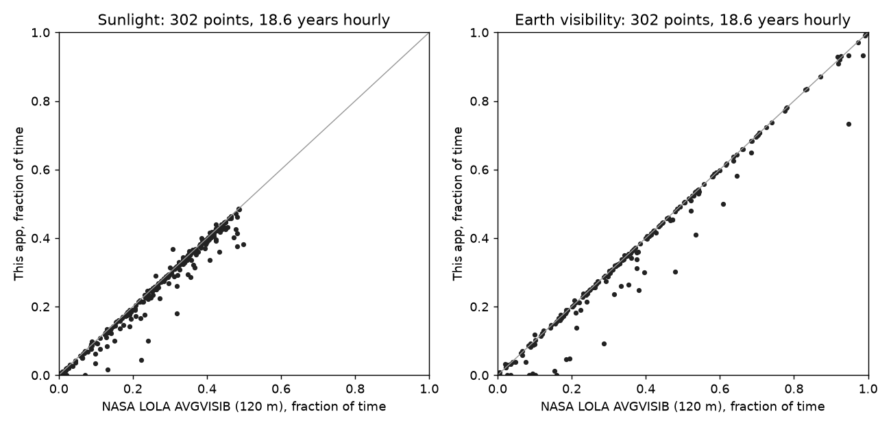

# Lunar Landing Site Navigator

**Pick any spot near the Moon's south pole and find out: would a lander there get sunlight for power, and could it talk to Earth?**

Built by team **1.5 Degrees Lunar** for the NASA Space Apps Challenge 2026.

**Try it:** https://lunar-landing-site-navigator-seven.vercel.app/

---

## The problem

NASA plans to land astronauts near the Moon's south pole (Artemis III). Landing there is hard for two reasons:

- **The Sun stays low.** At the pole it never climbs high in the sky. It circles just above the horizon, so a nearby mountain can block it for days. No Sun means no solar power.
- **Earth comes and goes.** Seen from the pole, Earth slowly rises above and sinks below the horizon over about a month. When it's hidden, a lander can't radio home.

A spot a few hundred metres away can be completely different. Tools to work this out exist, but they are built for specialists and slow to use. This app makes it quick and clear for mission planners, teachers, students and anyone curious.

## How to use it

1. **Pick one of NASA's nine possible landing regions.**
2. **Descend** to its real 3D terrain.
3. **Click any spot** (or type its coordinates).

You get a plain answer straight away: **Good, Fair or Poor** for landing there now, when the Sun sets, when Earth goes out of view, and how much of the time each is up.

## What you can do

- **Explore a 3D Moon** with the real Sun and Earth in the sky, at their true positions for any date from 2023 to 2028.
- **Stand on the surface** at eye level and look toward the Sun or Earth over the real horizon.
- **See the next 30 days at a glance:** when there's sunlight, when Earth is in view, the longest night.
- **Plan for delays:** a calendar rates every possible landing day of a month, in case the launch slips.
- **Find the best spots:** the app checks the whole area at once and lists the flattest places with the most sunlight and Earth contact.
- **Compare up to three spots side by side.**
- **Simple or Planner mode:** plain answers for everyone, with every number one click away.

## Can you trust it?

We compared the app against **NASA's own maps** of how often places near the south pole see the Sun and Earth. Over 18.6 years, at 302 spots, our answers are typically within **half a percentage point** of NASA's.



We also tested the calculation on two real landings (they aren't sites in the app):

- **IM-2 Athena (2025)** landed inside one of the app's regions. NASA's map says that spot is sunlit 46.5% of the time; we say 46.3%.
- **Chandrayaan-3 (2023)** landed outside the app's regions, so we replayed it with the same calculation outside the app. It puts the Sun 8.6° above the horizon at touchdown, exactly what NASA JPL gives, and has the Sun setting on 4 September, the day ISRO put the lander to sleep for the lunar night.

Every part of the app has an automatic check like these. The full list is on the app's **How it works** page.

## Where the data comes from

All real, all public:

- **The Moon's ground:** NASA's Lunar Reconnaissance Orbiter laser measurements (LOLA), 40 m detail near the pole.
- **Where the Sun and Earth are:** NASA JPL Horizons, the same system NASA uses to navigate spacecraft.
- **The landing regions:** NASA's nine Artemis III candidate regions, placed at the official crater and mountain positions (IAU).
- **The 3D globe:** NASA's CGI Moon Kit (colour from LRO's camera, LROC) and LOLA's global height map; Earth from NASA Earth Observatory's Blue Marble, Black Marble (night lights) and cloud images.
- **For testing only:** NASA's south-pole sunlight maps, LROC images of past landing sites, and ISRO's Chandrayaan-3 updates.

Anything the app chooses itself (such as the Good/Fair/Poor rules) is labelled as ours in the app. The 8° slope limit for landing is NASA's.

## What it can't do (yet)

- It sees mountains and craters, but not individual boulders.
- It measures how long there's sunlight, not how many watts a solar panel would make.
- "Can talk to Earth" means Earth is in plain view, not a full radio model.
- Dates run from 2023 to 2028, and the 3D globe is sharpest near the south pole.

---

## For developers

**Run it on your computer** (needs [Node.js](https://nodejs.org) 20 or newer):

```bash
cd web
npm install
npm run dev
```

Then open http://localhost:3000.

**How it works, briefly:** for a clicked spot, the app looks out in 720 directions and follows the real terrain 200 km in each, allowing for the Moon's curvature, to draw the skyline. It then compares the Sun and Earth (treated as discs, not points) with that skyline at every moment of the chosen dates. The best-spot search runs the same check on the graphics chip for about 260,000 spots at 360 moments each (about 189 million lines of sight in a few seconds). The site is static files with no server.

**Project layout:**

| Folder | What's in it |
|---|---|
| `web/` | The app (Next.js, React, three.js). The calculation engine is in `web/lib/`. |
| `web/scripts/` | Automatic accuracy checks, e.g. `node scripts/check-calendar.ts ../pipeline/cache/skyline_refs.json` |
| `pipeline/` | Python tools that prepared the data from NASA's files and ran the NASA comparison (`validate_illumination.py`). |

## Team

**1.5 Degrees Lunar**, NASA Space Apps Challenge 2026

- **Ashu Sharma**, Team Lead · Product & Engineering Lead
- **Fadia Mokadmi**

Built with help from Claude (Anthropic) as an AI coding assistant.

## Sources

Used by the app:

- NASA JPL Horizons (DE441): https://ssd.jpl.nasa.gov/horizons/
- LOLA terrain, south-pole 40 m / 240 m and global LDEM_64 (NASA PDS): https://pds-geosciences.wustl.edu/lro/lro-l-lola-3-rdr-v1/lrolol_1xxx/data/lola_gdr/
- NASA SVS CGI Moon Kit: https://svs.gsfc.nasa.gov/4720/
- NASA Earth Observatory (Blue Marble, Black Marble 2012, clouds): https://earthobservatory.nasa.gov/
- IAU Gazetteer of Planetary Nomenclature (USGS): https://planetarynames.wr.usgs.gov/
- NASA Artemis III candidate regions: https://www.nasa.gov/news-release/nasa-provides-update-on-artemis-iii-moon-landing-regions/
- HLS 8° landing requirement (Aerospace America): https://aerospaceamerica.aiaa.org/features/the-choice/

Used only to test the app:

- LOLA sunlight and Earth-visibility maps (PGDA product 69): https://pgda.gsfc.nasa.gov/products/69
- LROC landing-site images (NASA / Arizona State University): https://www.lroc.asu.edu/
- ISRO Chandrayaan-3 updates: https://www.isro.gov.in/
